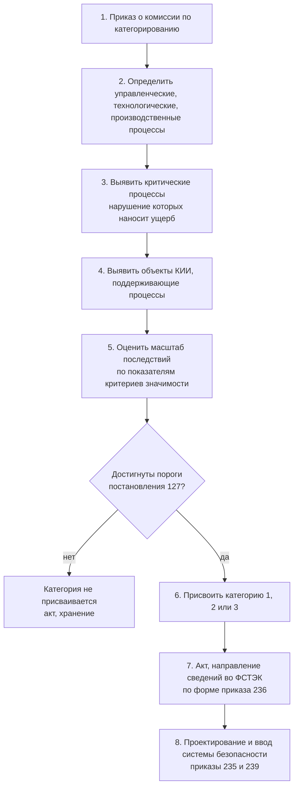

# Категорирование и категория значимости КИИ

Версия: 2026-10-13 · Связанные документы: [threat-model.md](threat-model.md), [attack-surface.md](attack-surface.md), [SECURITY_AUDIT_FSTEC.md](../../SECURITY_AUDIT_FSTEC.md).

> **Важно.** Категорию значимости присваивает **оператор** объекта критической информационной инфраструктуры (КИИ), а не разработчик программного обеспечения. Она зависит от того, какие критические процессы организации поддерживает информационная система и какой ущерб причинит нарушение её работы. Разработчик платформы может подготовить исходные данные, технические характеристики и меры защиты — этот документ делает именно это. **Итоговая категория в документе не присваивается**: у разработчика нет данных об организации-операторе. Ниже — методика, предварительный анализ применимости и рабочий лист для оператора.

Нормативные цифры (пороговые значения показателей) в документ намеренно не перенесены: их нужно брать из действующей редакции постановления № 127 и сверять на дату категорирования.

---

## 1. Нормативная основа

| Документ | Что определяет |
|----------|----------------|
| Федеральный закон от 26.07.2017 № 187-ФЗ «О безопасности критической информационной инфраструктуры РФ» | субъекты и объекты КИИ, обязанности субъектов, сферы деятельности |
| Постановление Правительства РФ от 08.02.2018 № 127 | правила категорирования, перечень показателей критериев значимости и их значения, три категории значимости |
| Приказ ФСТЭК России от 22.12.2017 № 236 | форма направления сведений о результатах категорирования |
| Приказ ФСТЭК России от 21.12.2017 № 235 | требования к созданию систем безопасности значимых объектов КИИ и обеспечению их функционирования |
| Приказ ФСТЭК России от 25.12.2017 № 239 | требования по обеспечению безопасности значимых объектов КИИ (меры защиты, адаптация, требования к ПО и СЗИ) |
| Указ Президента РФ от 30.03.2022 № 166 и последующие акты | ограничения на использование иностранного программного обеспечения на значимых объектах КИИ |
| Методика оценки угроз безопасности информации ФСТЭК (05.02.2021) | порядок формирования модели угроз |

Реквизиты и редакции следует перепроверять на момент работ: акты менялись.

---

## 2. Применимость к платформе

### 2.1. Платформа как объект

Платформа lowcode — **программное обеспечение общего назначения** для построения прикладных систем. Сама по себе она не является значимым объектом КИИ. Значимым объектом может стать **информационная система оператора**, построенная на платформе, если она:

1. принадлежит субъекту КИИ (сфера: здравоохранение, наука, транспорт, связь, энергетика, банковская сфера и иные финансовые рынки, топливно-энергетический комплекс, атомная энергия, оборонная, ракетно-космическая, горнодобывающая, металлургическая, химическая промышленность — перечень закреплён в 187-ФЗ, ст. 2);
2. обеспечивает управление, технологический или производственный процесс, который оператор признал критическим;
3. по результатам расчёта показателей получает категорию (1, 2 или 3).

Если система не поддерживает критический процесс или ущерб ниже установленных порогов, значимого объекта нет — тогда требования приказа № 239 не обязательны, но применяются как лучшая практика (и в любом случае действуют требования 152-ФЗ, если обрабатываются персональные данные).

### 2.2. Что это значит для сертификационных работ

- Требования приказа № 239 к программному обеспечению и СЗИ применяются к **конкретному значимому объекту**, поэтому оператор вправе (и обязан) выбрать набор мер под категорию.
- Для 1–2 категорий оператор обычно ожидает от поставщика платформы подтверждения безопасной разработки и сертифицированных СЗИ в составе системы защиты. Для 3 категории объём меньше.
- Происхождение кода: платформа является форком Corteza (Apache-2.0), зарубежной по происхождению кодовой базы. Если оператор должен применять российское ПО (Указ № 166 и связанные акты), вопрос о включении платформы в реестр отечественного ПО и о доле собственной разработки нужно решить **до** категорирования — он влияет на допустимость использования, а не на категорию.

---

## 3. Порядок категорирования (для оператора)

Результат пересматривается не реже одного раза в 5 лет, а также при изменении показателей и состава объектов.

---

## 4. Критерии значимости

Постановление № 127 определяет значимость по пяти группам показателей. Для каждой группы оператор отвечает на вопрос: «Что произойдёт, если информационная система на платформе перестанет работать, будет скомпрометирована или исказит данные?»

| Группа | Содержание оценки | Данные, которые нужны от оператора |
|--------|--------------------|-------------------------------------|
| Социальная | нарушение жизнеобеспечения, транспортного сообщения, связи, оказания госуслуг; число пострадавших | число людей, зависящих от процесса; длительность простоя |
| Политическая | ущерб интересам государства в международных отношениях, внутриполитической обстановке | — |
| Экономическая | ущерб бюджетам РФ, убытки организации, доля в ВВП/отрасли | годовая выручка, расчёт убытков при простое, штрафы |
| Экологическая | воздействие на окружающую среду | объём возможного загрязнения, территория |
| Для обороны, безопасности и правопорядка | влияние на обороноспособность, безопасность государства | — |

Для каждого показателя в постановлении заданы значения по категориям; при несоответствии всем порогам значимость не присваивается. **Пороговые значения берутся из таблицы постановления № 127 на дату категорирования.**

---

## 5. Предварительный анализ: на каких критерии влияет платформа

Таблица помогает оператору быстро понять, какие из показателей применимы в его случае. Она не присваивает категорию.

| Сценарий использования платформы | Затрагиваемые данные и процессы | Потенциально затрагиваемые критерии | Ключевые технические вопросы |
|----------------------------------|---------------------------------|------------------------------------|------------------------------|
| Внутренний учёт, согласование документов, CRM, заявки | бизнес-данные, персональные данные | экономическая (убытки организации), при ПДн — 152-ФЗ | доступность, резервирование, разграничение прав |
| CMDB и мониторинг инфраструктуры (агент `cmdb`, `scan-cidr`) | топология сети, инвентарь | косвенно — раскрытие инфраструктуры; зависит от объекта, который инвентаризируется | изоляция агента, защита модулей CMDB |
| Управление проектами и закупками (`invest`, `stroykontrol`) | проекты, сметы, закупки | экономическая; для строительства объектов инфраструктуры — социальная | целостность и неотказуемость согласований |
| Резервное копирование (`backup`) | копии данных организации | зависит от копируемых систем | шифрование, права, изоляция |
| Интеграция с АСУ ТП и технологическими данными | технологические процессы | социальная, экономическая, экологическая | **не рекомендуется** подключать платформу к контурам АСУ ТП без отдельной оценки; платформа не предназначена для управления технологическим процессом в реальном времени |
| AI-ассистент и автоматизация на данных критического процесса | записи, документы, промпты | как у основного процесса + раскрытие данных модели | локальная модель, подтверждение мутаций, политики данных |

**Вывод.** Типичное использование платформы (учёт, согласования, документооборот, аналитика) не управляет критическим технологическим процессом и в большинстве случаев не приводит к значимому объекту КИИ. Оценка меняется, если на платформе строится система, **обеспечивающая** критический процесс субъекта КИИ или обрабатывающая информацию, нарушение которой достигает порогов постановления № 127. Для такого случая используйте рабочий лист раздела 6.

---

## 6. Рабочий лист оператора

Заполняется комиссией оператора. Поля со знаком «?» — исходные данные организации.

### 6.1. Идентификация

| Поле | Значение |
|------|----------|
| Субъект КИИ, сфера | ? |
| Критический процесс | ? |
| Информационная система на платформе (название, версия) | ? |
| Развёртывание (контур, ЦОД, облако) | ? |
| Обрабатываемая информация (в т.ч. ПДн, ГТ, КТ, иная охраняемая) | ? |
| Подключение к АСУ ТП / внешним сетям | ? |
| Число пользователей, число внешних интеграций | ? |

### 6.2. Оценка показателей

| Группа критериев | Показатель из постановления № 127 | Последствие при нарушении (описание, значение) | Достигнут порог? | Категория |
|------------------|------------------------------------|-----------------------------------------------|------------------|-----------|
| Социальная | ? | ? | да / нет | 1 / 2 / 3 / — |
| Политическая | ? | ? | да / нет | ? |
| Экономическая | ? | ? | да / нет | ? |
| Экологическая | ? | ? | да / нет | ? |
| Оборона, безопасность | ? | ? | да / нет | ? |
| **Итоговая категория** | максимальная из присвоенных по критериям | | | ? |

Категория присваивается по **наибольшему** значению среди критериев.

### 6.3. Исходные данные для проектирования защиты

После присвоения категории оператор переносит в проект системы безопасности:

- результаты [threat-model.md](threat-model.md), адаптированные под свои процессы и нарушителей;
- перечень точек входа из [attack-surface.md](attack-surface.md) и решение, какие компоненты платформы включаются (регистрация, MCP, скрипты, агенты, федерация, SCIM — все они отключаются или включаются осознанно);
- набор мер приказа № 239 из раздела 7 модели угроз и компенсирующие меры.

---

## 7. Профиль безопасной конфигурации для значимого объекта

Рекомендуемое состояние платформы при использовании в значимом объекте (независимо от категории — уточняется оператором):

| Область | Требование | Источник |
|---------|-----------|----------|
| Регистрация | `auth.internal.signup.enabled = false` | T-03 |
| MFA | обязательна для администраторов, рекомендуется для всех | T-01 |
| Отладочные маршруты | `EnableDebugRoute` выключен | N14 |
| Документация и версия | `/api/docs`, `/api/manual`, `/api/architecture`, `/version`, `/healthcheck` не доступны извне | attack-surface.md, раздел 2.1 |
| Скрипты | `MCP_ENABLE_SCRIPTS` выключен; при необходимости — изоляция на уровне ОС | T-19 |
| MCP SSE | `MCP_SSE_ADDR` только во внутренней сети; наружу не публикуется | T-32 |
| Агенты | порты закрыты сетью; отдельные пользователи с минимальными правами; `AGENT_SHARED_SECRET` длинный и ротируется | T-04, T-22, T-23 |
| TLS | обязательно на периметре; `SYSTEM_HTTP_CLIENT_TSL_INSECURE` не используется | T-37 |
| Секреты | `AUTH_SECRET` и прочие хранятся в менеджере секретов, права на `.env` ограничены | T-35 |
| Журналы | `actionlog` и журнал приложения передаются во внешнюю систему (SIEM / ГосСОПКА) | АУД, ИНЦ |
| LLM | локальная модель; политика, какие модули доступны AI | T-29 |
| Обновления | `govulncheck`, `osv-scanner` в CI; образы сканируются `trivy` | T-33, T-34 |

---

## 8. Финальный чеклист

Статус: **сделано** — реализовано в коде и проверено; **частично** — есть меры, но остаются работы; **оператор** — вне зоны разработчика; **открыто** — работа не выполнена.

### 8.1. Подготовка документации

| Пункт | Статус | Где |
|-------|--------|-----|
| Аудит безопасности кода и зависимостей | сделано | [SECURITY_AUDIT_FSTEC.md](../../SECURITY_AUDIT_FSTEC.md) |
| Модель угроз разработчика | сделано | [threat-model.md](threat-model.md) |
| Описание поверхности атаки | сделано | [attack-surface.md](attack-surface.md) |
| Методика и рабочий лист категорирования | сделано | этот документ |
| Присвоение категории значимости | **оператор** | раздел 6 |
| Модель угроз конкретной ИС | **оператор** | threat-model.md, раздел 9 |
| Проект системы безопасности ЗОКИИ (приказ № 235) | **оператор** | — |

### 8.2. Технические работы разработчика

| Пункт | Статус | Комментарий |
|-------|--------|-------------|
| Сканирование зависимостей Go (`govulncheck`, `osv-scanner`) | сделано | уязвимостей в достижимом коде нет; остаются 2 без патча |
| Сканирование зависимостей JS | частично | осталось 182 вхождения (`xlsx`, `echarts`, `vitest`, `mxgraph` — смена major) |
| Статический анализ (`gosec`, `staticcheck`) | сделано | исправлены реальные ошибки, остаток описан в аудите |
| Статический анализ Svace | **открыто** | инструмент на стенде недоступен |
| Сканирование образов (`trivy`) | **открыто** | образы не собирались/не сканировались |
| Аутентификация в SDK агентов, CORS | **открыто** | A-1, A-2 — высокий приоритет |
| Отдельные пользователи агентов, срок токена enroll | **открыто** | A-3, A-4 |
| Лимиты тел запросов на формах | **открыто** | G120 |
| Блокировка внутренних адресов для исходящих запросов | **открыто** | T-14 |
| Аутентификация MCP SSE | **открыто** | T-32 |
| Профиль безопасной конфигурации | частично | раздел 7 описан; исполняемого профиля (provision) нет |
| SBOM, подписанные артефакты, воспроизводимая сборка | **открыто** | — |
| Сертифицированные СЗИ и испытания ПО | **оператор / разработчик** | зависит от категории и выбранной схемы оценки соответствия |

### 8.3. Процессы

| Пункт | Статус |
|-------|--------|
| Процесс управления уязвимостями (сканирование, сроки устранения) | частично: инструменты есть, регламента нет |
| Контроль недекларированных возможностей, безопасная разработка | частично: AI guard и ревью есть, процедура не оформлена |
| Реагирование на инциденты и взаимодействие с ГосСОПКА | **оператор** |
| Резервирование и восстановление | **оператор**, технические средства — агент `backup` |

---

## 9. Что запросить у оператора

Перед любой оценкой категории разработчику и оператору нужно согласовать:

1. Сфера и перечень критических процессов субъекта КИИ.
2. Какие из них поддерживает система на платформе и в каком режиме (основной, вспомогательный, резервный).
3. Допустимая длительность простоя и последствия по каждой группе критериев.
4. Перечень информации, обрабатываемой системой (включая ПДн и информацию ограниченного доступа).
5. Схема развёртывания: сетевые зоны, внешние подключения, используемые компоненты платформы (агенты, MCP, скрипты, AI).
6. Требования к отечественному происхождению ПО и к сертификации.

На основе ответов уточняется профиль раздела 7 и перечень мер.
