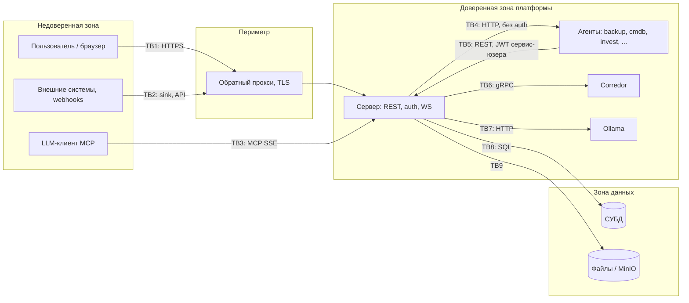

# Модель угроз безопасности информации платформы lowcode

Версия: 2026-10-13 · Основа: код ветки `2026.10.x`, [attack-surface.md](attack-surface.md), [SECURITY_AUDIT_FSTEC.md](../../SECURITY_AUDIT_FSTEC.md).

Документ — **техническая модель угроз разработчика**: она описывает, что и от кого нужно защищать в самой платформе, и служит исходными данными для модели угроз **оператора** значимого объекта КИИ. Окончательную модель угроз конкретной информационной системы утверждает оператор (см. раздел 9 и [kii-categorization.md](kii-categorization.md)).

Методическая основа: «Методика оценки угроз безопасности информации» ФСТЭК России (05.02.2021), банк данных угроз БДУ ФСТЭК, приказ ФСТЭК № 239 (меры защиты значимых объектов КИИ). Для систематизации технических угроз использованы STRIDE и CWE.

---

## 1. Область и допущения

**В области:** сервер платформы (`server/`), веб-приложения (`client3/`), агенты (`agents/`), конфигурация развёртывания (Docker, переменные окружения), интеграции (LLM, MCP, IdP, СУБД, хранилища).

**Вне области:** инфраструктура оператора (сеть, ОС, гипервизор, СЗИ периметра), процессы организации, физическая защита, прикладные приложения, собранные на платформе (модули и страницы заказчика), — они дают собственные угрозы.

**Допущения о развёртывании** (при их нарушении риски растут — раздел 8):

1. Сервер публикуется только через обратный прокси/шлюз с TLS; прямого доступа к портам агентов, MCP, Corredor, СУБД, MinIO, Ollama из недоверенных сетей нет.
2. Администраторы платформы и ОС доверенные; доступ к `.env` и секретам ограничен.
3. Резервные копии шифруются и хранятся отдельно.
4. LLM работает в контуре оператора (локальный Ollama), данные не уходят в публичные облака, если иное не согласовано.

---

## 2. Защищаемые активы

| ID | Актив | Свойства | Где хранится |
|----|-------|----------|--------------|
| AS1 | Данные записей Compose (бизнес-данные заказчика, персональные данные) | К, Ц, Д | СУБД (DAL), хранилище файлов |
| AS2 | Учётные данные и секреты: пароли (bcrypt), TOTP-секреты, OTP, токены, `AUTH_SECRET`, `AGENT_SHARED_SECRET`, ключи MinIO/SMTP/LLM | К, Ц | СУБД, окружение, файлы `.env` |
| AS3 | Токены доступа и сессии (JWT, cookie), подписанные URL | К, Ц | клиент, сервер |
| AS4 | Конфигурация приложений: модули, страницы, workflow, цепочки правил, промпты, навыки, скрипты | Ц, Д | СУБД |
| AS5 | Права доступа (RBAC-правила, роли) | Ц | СУБД |
| AS6 | Журналы аудита (`actionlog`), трассировка AI-шагов | Ц, Д | СУБД, файлы |
| AS7 | Вложения и бэкапы | К, Ц, Д | FS, MinIO/S3 |
| AS8 | Сервис платформы (доступность API, workflow по расписанию, агенты) | Д | процессы |
| AS9 | Исполняемая среда (ОС, контейнеры, зависимости, образы) | Ц | хост, реестр образов |
| AS10 | Модели и промпты LLM | Ц | Ollama, СУБД |

К — конфиденциальность, Ц — целостность, Д — доступность.

---

## 3. Границы доверия и потоки данных

| ID | Граница | Что пересекает | Контроль на границе |
|----|---------|----------------|---------------------|
| TB1 | Интернет/сеть пользователей → сервер | запросы, файлы, учётные данные | TLS на прокси, аутентификация, CSRF, rate-limit токенов |
| TB2 | Внешние системы → сервер | вызовы sink, REST интеграций, SCIM | подпись URL sink, секрет SCIM, OAuth2-клиенты |
| TB3 | LLM-клиент → MCP | вызовы инструментов | **нет аутентификации на транспорте SSE** |
| TB4 | Сервер → агент | команды запуска операций | **нет аутентификации у агента**, `CORS: *` |
| TB5 | Агент → сервер | чтение/запись записей | JWT identity `corteza-service` (365 дней) |
| TB6 | Сервер → Corredor | скрипты | сеть |
| TB7 | Сервер → LLM | контекст, содержимое записей | сеть |
| TB8–9 | Сервер → данные | SQL, файлы | учётная запись СУБД, ключи S3 |

---

## 4. Нарушители

| ID | Нарушитель | Тип | Потенциал | Возможности |
|----|-----------|-----|-----------|-------------|
| V1 | Внешний анонимный пользователь | внешний | базовый | доступ к публичным маршрутам, подбор паролей, фишинг, сканирование |
| V2 | Зарегистрированный пользователь с низкими правами | внутренний | базовый повышенный | вызовы API в рамках ролей, загрузка файлов, составление запросов |
| V3 | Пользователь-разработчик приложений (пишет workflow, цепочки, шаблоны, скрипты) | внутренний | базовый повышенный | выполнение кода платформы, вызов HTTP, настройка прав на своих объектах |
| V4 | Администратор платформы | внутренний | средний | полный доступ к настройкам и данным |
| V5 | Администратор инфраструктуры/СУБД | внутренний | средний | доступ к хостам, секретам, резервным копиям |
| V6 | Скомпрометированный агент или внутренний хост | внешний/внутренний | базовый повышенный | токен сервисного пользователя, доступ в сеть агентов |
| V7 | Поставщик ПО/зависимостей (supply chain) | внешний | средний–высокий | вредоносные обновления, подмена образов |
| V8 | Злоумышленник через AI (инъекция в данные, которые читает LLM) | внешний | базовый | управление поведением LLM через содержимое записей, файлов, писем |
| V9 | Целенаправленная группировка (APT) | внешний | высокий | цепочки эксплойтов, длительное присутствие |

Для значимого объекта КИИ 1–2 категории оператору следует рассматривать нарушителей V7 и V9; для 3 категории — как минимум V1–V6 и V8.

---

## 5. Каталог угроз

Оценка остаточного риска даётся по шкале **Н/С/В** (низкий / средний / высокий) с учётом уже реализованных мер и допущений раздела 1.

### 5.1. Аутентификация и сессии

| ID | Угроза (STRIDE) | Нарушитель | Сценарий | Существующие меры | Остаточный риск | Рекомендация |
|----|-----------------|------------|----------|-------------------|-----------------|--------------|
| T-01 | Spoofing | V1 | подбор паролей, credential stuffing на `/auth` | bcrypt, политика паролей, rate-limit токенов, MFA (TOTP, Email OTP), запрет повторного пароля | С | включить обязательный MFA для администраторов; блокировка по числу неудач |
| T-02 | Spoofing | V1 | предсказание секретов, токенов и ID сессий | **исправлено:** `pkg/rand` и секрет TOTP на `crypto/rand` (п. 12 аудита) | Н | выпущенные ранее токены ротировать |
| T-03 | Spoofing | V1 | самостоятельная регистрация посторонних учётных записей | подтверждение email (при SMTP) | **В**, если регистрация открыта | отключить `auth.internal.signup.enabled` в промышленной среде |
| T-04 | Elevation | V6 | кража `AGENT_SHARED_SECRET` → токен сервисного пользователя на 365 дней через `/agents/enroll` | сравнение за постоянное время; маршрут только при заданном секрете | **В** | ограничить частоту, сократить срок, раздельные секреты и пользователи на агента, ротация |
| T-05 | Spoofing | V2 | кража JWT/cookie (XSS, перехват) | cookie `HttpOnly` и `Secure` (по настройке), CSRF с `SameSite=Strict`; `v-html` → `v-text` в компонентах `CPrompt*`; HMAC-SHA256 для подписей | С | CSP, ограничение времени жизни токенов, отзыв токенов (есть) |
| T-06 | Spoofing | V9 | подмена IdP/подпись SAML | `goxmldsig` 1.6.0, проверка подписи | С | периодически обновлять зависимость, тесты XSW |

### 5.2. Контроль доступа и целостность данных

| ID | Угроза | Нарушитель | Сценарий | Меры | Риск | Рекомендация |
|----|--------|------------|----------|------|------|--------------|
| T-07 | Elevation | V2 | обход RBAC через менее проверяемый путь (MCP, чат, агенты, workflow) | проверки в сервисном слое; `withAuth` не подставляет «пользователя 1»; `run-as` для событий | С | регулярный тест «одно действие — все пути» для каждой мутации |
| T-08 | Tampering | V3 | workflow с `run-as` повышенного пользователя выполняет чужие данные | `run-as` задаётся явно, события AI требуют `run-as` | С | ограничить, кто может задавать `run-as` |
| T-09 | Info disclosure | V2 | чтение чужих записей через экспорт, поиск, RAG, чат | RBAC на модулях и полях; инструменты чата вызывают те же сервисы с проверкой прав | С | подтвердить тестами, что RAG, discovery и чат не отдают записи сверх прав пользователя |
| T-10 | Repudiation | V4 | отрицание действий администратора | `actionlog`: аутентификация, пользователи, роли, вложения, federation, automation | Н | вынос журнала во внешнее неизменяемое хранилище (SIEM), синхронизация времени |
| T-11 | Tampering | V3, V4 | подмена конфигурации приложений без следа | версионирование страниц, модулей, графиков, цепочек, workflow, промптов, навыков | Н | включить ревизии записей для критичных модулей |

### 5.3. Ввод данных и веб-слой

| ID | Угроза | Нарушитель | Сценарий | Меры | Риск | Рекомендация |
|----|--------|------------|----------|------|------|--------------|
| T-12 | Injection | V2 | SQL-инъекция | goqu с параметризацией; единственный `Sprintf` — миграции | Н | перевести `upgrade_fixes.go:234` на плейсхолдеры |
| T-13 | XSS | V2 | stored/DOM XSS через значения полей, комментарии, `v-html` | исправлены `CPrompt*.vue`; шаблоны html/template | С | CSP; аудит оставшихся `v-html` в `client3` |
| T-14 | SSRF | V3 | `inlineRemote` в шаблонах, workflow `http`, APIGW → внутренние адреса | `http(s)`, таймаут, лимит размера; `gotenbergPDF` не принимает URL от пользователя | **В** для V3 | блокировать приватные диапазоны/loopback для исходящих запросов по умолчанию |
| T-15 | Tampering | V2 | загрузка вредоносных файлов, зипбомба, полиглот | подписанные URL, версионирование; библиотека `imaging` с известным DoS | С | антивирусная проверка, лимиты размеров, `Content-Disposition: attachment` для неизвестных типов |
| T-16 | DoS | V1 | тела запросов без лимита (G120), медленные клиенты, тяжёлые запросы | `ReadHeaderTimeout` для служебных серверов | С | лимиты тел на маршрутах форм, ограничение частоты на периметре |
| T-17 | Path traversal | V1 | `../` в путях SPA и ресурсов | нормализация путей (п. 13, 14 аудита) | Н | — |
| T-18 | Info disclosure | V1 | текст ошибок и паник, версия, документация | клиенту — «internal server error» (п. 19 аудита) | С | закрыть `/version`, `/api/docs`, `/__routes`, `/debug` |

### 5.4. Выполнение кода и расширения

| ID | Угроза | Нарушитель | Сценарий | Меры | Риск | Рекомендация |
|----|--------|------------|----------|------|------|--------------|
| T-19 | Elevation/RCE | V3 | `gonec`/Corredor/скрипты выходят из песочницы, запускают процессы | `MCP_ENABLE_SCRIPTS` выключен по умолчанию; белый список импортов; rulesgo-узел `gonec` без runner | С (при выключенных скриптах — Н) | OS-изоляция (gVisor/контейнер, seccomp) если скрипты нужны |
| T-20 | RCE | V2 | разбор файлов внешними процессами (`pkg/rag` PDF/CAD) | аргументы без shell | С | запуск под отдельной учётной записью, ограничения ресурсов |
| T-21 | Tampering | V3 | вредоносный навык (skill) или промпт из библиотеки меняет поведение агента | версии неизменяемы, активация и откат, лимиты размера, символьные ссылки пропускаются; навыки не расширяют права | Н | подписывать и проверять удалённые навыки; доверять только своим агентам |

### 5.5. Агенты и интеграции

| ID | Угроза | Нарушитель | Сценарий | Меры | Риск | Рекомендация |
|----|--------|------------|----------|------|------|--------------|
| T-22 | Elevation/DoS | V1, V6 | прямой вызов `POST /api/jobs`, `/api/call/{op}` у агента: сканирование сети, бэкап, перезапись | сетевая изоляция (допущение 1) | **В** | аутентификация в SDK (A-1), убрать `CORS: *` (A-2), раздельные токены |
| T-23 | Tampering | V6 | скомпрометированный агент пишет в Compose под `corteza-service` | — | **В** | отдельный пользователь и минимальные права на агента (A-4) |
| T-24 | Info disclosure | V6 | `cmdb` собирает топологию сети и отдаёт её без защиты | — | С | шифрование и права на модули CMDB |
| T-25 | Tampering | V2 | вызов цепочек/workflow из недоверенных систем через sink | подпись URL, срок | С | включать срок действия подписи по умолчанию |
| T-26 | Info disclosure | V5 | утечка резервных копий | `backup` через restic (шифрование) | С | управление ключами restic, раздельное хранение |

### 5.6. Угрозы, специфичные для AI

| ID | Угроза | Нарушитель | Сценарий | Меры | Риск | Рекомендация |
|----|--------|------------|----------|------|------|--------------|
| T-27 | Prompt injection (непрямая) | V8 | вредоносный текст в записи, файле, письме заставляет агента вызвать инструмент | подтверждение мутирующих действий («да»), `Mutating`, режим `deferConfirm` и approval-flow, область инструментов агента, бюджет вызовов | С | показывать подтверждающему **реальные** параметры вызова; не давать LLM инструменты вне задачи |
| T-28 | Excessive agency | V8, V3 | агент с широкими инструментами изменяет/удаляет данные | инструмент `create_/delete_` требует подтверждения; навыки не расширяют права | С | минимизировать набор инструментов по умолчанию, раздельные роли агентов |
| T-29 | Info disclosure | V8 | содержимое записей уходит в модель/логи/трассировку | локальный Ollama; трасса усечена `TracePreviewLimit` | С | политики: какие модули разрешены для RAG и чата; маскирование ПДн |
| T-30 | DoS / затраты | V2 | цикл вызовов модели, большие контексты | `Budget` (токены, вызовы), дедлайн шага, таймауты | Н | — |
| T-31 | Tampering | V7 | подмена модели Ollama или навыков на удалённом агенте | приоритет источников навыков: `db`, затем `file`, затем `remote` (побеждает первый) | С | закрепить модель по digest; запретить `remote` навыки вне доверенных агентов |
| T-32 | Spoofing | V1 | MCP SSE без аутентификации принимает вызовы | идентичность из контекста; `withAuth` не подставляет привилегированного пользователя для SSE | С | не публиковать `MCP_SSE_ADDR` вне доверенной сети; аутентификация на транспорте |

### 5.7. Цепочка поставки и среда

| ID | Угроза | Нарушитель | Сценарий | Меры | Риск | Рекомендация |
|----|--------|------------|----------|------|------|--------------|
| T-33 | Supply chain | V7 | уязвимая или подменённая зависимость | `govulncheck`, `osv-scanner` (Go: 2 остаточных, JS: 182), vendor | С | политика обновлений, SBOM, подпись артефактов |
| T-34 | Supply chain | V7 | уязвимый базовый образ | — | С | `trivy`, закрепление образов по digest, непривилегированный пользователь в контейнере |
| T-35 | Info disclosure | V5 | секреты в `.env`, переменных окружения, логах | — | С | менеджер секретов, права 0600, не логировать значения |
| T-36 | Tampering | V9 | вредоносная правка кода репозитория | ревью, `scripts/verify-ai.sh` (AI guard) | С | подписанные коммиты, защита веток, воспроизводимая сборка |
| T-37 | Info disclosure | V5 | отключена проверка TLS (`SYSTEM_HTTP_CLIENT_TSL_INSECURE=1`) | по умолчанию выключено | Н | запретить в промышленной среде политикой |

---

## 6. Критические сценарии (цепочки)

1. **Внешний → внутренний через агент.** Администратор открывает вредоносную страницу → браузер шлёт `POST /api/jobs` на агент в локальной сети (CORS `*`, без auth) → запускается сканирование/бэкап. Закрывается A-1, A-2 (T-22).
2. **Открытая регистрация → AI.** Постороннее лицо регистрируется (T-03) → пишет в поле записи инструкцию для LLM (T-27) → агент с широкими инструментами изменяет данные. Закрывается отключением регистрации, минимальным набором инструментов и показом реальных параметров на подтверждение.
3. **Автор шаблона → внутренняя сеть.** Пользователь-разработчик использует `inlineRemote`/`http` на внутренний адрес (T-14) и получает данные внутренних систем. Закрывается блокировкой приватных адресов.
4. **Кража общего секрета агентов.** Утечка `AGENT_SHARED_SECRET` (T-04) → год работы токена сервисного пользователя с широкими правами (T-23).

---

## 7. Соответствие мерам приказа ФСТЭК № 239

Обобщённое сопоставление технических свойств платформы с группами мер. Подробный чеклист — в разделе 3 [SECURITY_AUDIT_FSTEC.md](../../SECURITY_AUDIT_FSTEC.md).

| Группа мер | Что даёт платформа | Что остаётся оператору |
|-----------|---------------------|------------------------|
| ИАФ | bcrypt, MFA, политика паролей, SAML/OIDC, rate-limit | политика учётных записей, интеграция с корпоративным IdP, отключение саморегистрации |
| УПД | RBAC на всех ресурсах, `run-as`, разграничение по ролям | ролевая модель организации, пересмотр прав |
| ОПС | — | ограничение программной среды на хостах |
| ЗНИ | — | учёт и защита носителей и бэкапов |
| АУД | `actionlog`, трассировка AI, версии конфигурации | централизованный сбор, хранение, анализ (SIEM) |
| АВЗ | `govulncheck`, `osv-scanner`, `gosec`, `staticcheck` в процессе разработки | антивирусная защита на хостах |
| ОЦЛ | версионирование, ревизии записей, HMAC-подписи | контроль целостности ПО и конфигурации на хостах |
| ОДТ | таймауты, бюджеты AI, перезапуск сессий после рестарта | резервирование, мониторинг, план восстановления |
| ЗСВ | — | изоляция виртуальной среды |
| ЗТС | — | физическая защита |
| ИНЦ | журналы, трассировка | процесс реагирования на инциденты |
| УКФ | — | управление конфигурацией, версиями |
| ОПС/ЗИС | TLS, CSRF, `SameSite`, заголовки | сегментация сети, МЭ, WAF, закрытие портов агентов и MCP |
| НДВ | `vendor`, ревизия зависимостей, статический анализ | процедура контроля НДВ и сертификационные испытания ПО (в т.ч. Svace) |

---

## 8. Последствия нарушения допущений

| Нарушено допущение | Последствие | Действие |
|--------------------|-------------|----------|
| Порты агентов доступны из недоверенных сетей | T-22/T-23 → **В** | закрыть сетью, ввести аутентификацию в SDK |
| Регистрация открыта | T-03, сценарий 2 → **В** | отключить |
| Скрипты включены (`MCP_ENABLE_SCRIPTS=true`) | T-19 → **В** | изоляция уровня ОС |
| LLM во внешнем облаке | T-29 → **В** | политика данных, локальная модель |
| Нет прокси с TLS | T-05, T-18 → **В** | включить TLS на периметре |

---

## 9. Что нужно оператору для финальной модели угроз

1. Определить объект оценки: какие процессы и информация обрабатываются на платформе (см. [kii-categorization.md](kii-categorization.md)).
2. Определить актуальных нарушителей и их потенциал по таблице раздела 4.
3. Для каждой угрозы из раздела 5 сопоставить БДУ ФСТЭК (УБИ), оценить возможность реализации и степень негативных последствий для **своих** процессов.
4. Исключить неактуальные угрозы с обоснованием, оформить перечень актуальных угроз.
5. Выбрать и адаптировать меры (приказ № 239), добавить компенсирующие там, где рекомендации раздела 5 не реализованы.
6. Переоценивать модель при изменении архитектуры, подключении новых агентов или версий.

---

## 10. План снижения остаточного риска

| Приоритет | Работа | Закрывает |
|-----------|--------|-----------|
| 1 | Аутентификация (общий секрет или JWT платформы) в SDK агентов; убрать `CORS: *`; `ReadHeaderTimeout` | T-22, A-1, A-2, A-5 |
| 1 | Отдельный пользователь с минимальными правами на каждого агента; срок токена enroll и ограничение частоты | T-04, T-23, A-3, A-4 |
| 1 | Отключить саморегистрацию и отладочные маршруты в промышленном профиле | T-03, T-18 |
| 2 | Блокировка приватных/loopback адресов для исходящих запросов шаблонов, workflow, APIGW | T-14 |
| 2 | Лимиты тел запросов на формах `auth/` | T-16 |
| 2 | Аутентификация MCP SSE на транспорте | T-32 |
| 2 | Показ реальных параметров вызова при подтверждении AI-действий | T-27 |
| 3 | `trivy`, SBOM, закрепление образов по digest, подписанные артефакты | T-33, T-34, T-36 |
| 3 | Замена `xlsx`, обновление `echarts`/`vitest`, замена `imaging` | T-15, T-33 |
